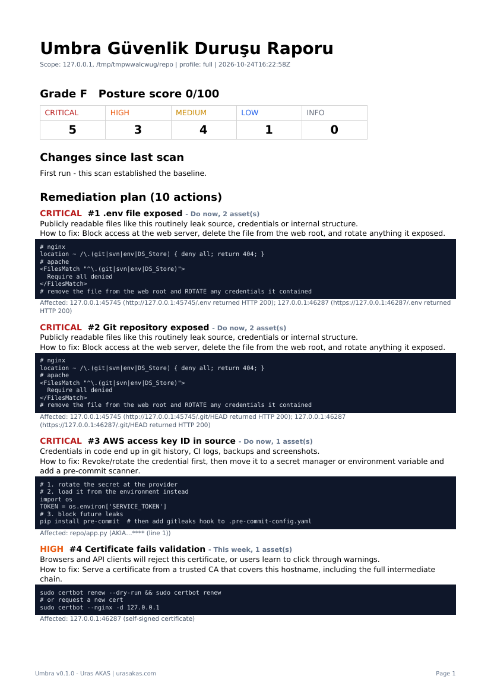

# 🌑 Umbra

[](https://github.com/urasec-labs/Umbra/actions/workflows/ci.yml)  

**Defensive attack-surface monitor with remediation-first reporting.**
Where recon tools ask *"what can an attacker see?"*, Umbra asks *"what did I leave exposed, and exactly how do I fix it?"*

Author: **Uras AKAS** · [urasakas.com](https://urasakas.com)



*Sample report generated against Umbra's own local test lab — see `docs/sample_report.html` / `.pdf`.*

## What it does

| Stage | Module | What you get |
|---|---|---|
| Inventory | `discovery` | Your domains/subdomains via CT logs (crt.sh), wordlist, optional `subfinder`; persistent inventory with **new / disappeared** detection |
| DNS | `dns_hygiene` | SPF, DMARC, CAA, **dangling CNAMEs** (subdomain-takeover risk) |
| Network | `ports` | Open ports on your own IPs vs. `policy.allowed_ports` (TCP connect, or `nmap` if installed). Shared CDN ranges are skipped |
| Crypto | `tls` | Expiry (warn/critical days), invalid chain/hostname, weak protocol/keys |
| Web | `headers` | Missing security headers, cookie flags, HTTP→HTTPS redirect, version disclosure |
| Web | `exposure` | Exposed `.git`, `.env`, backups, phpinfo, actuator, directory listing (content-validated, soft-404 aware) |
| Code | `secrets` | Hard-coded credentials & tracked `.env` files in `scope.paths` — values always redacted |
| Tools | `ext_tools` | `gitleaks`, `trivy`, `pip-audit`, `lynis` — used automatically when installed |

**Reports** (HTML + PDF + JSON) are built around a *remediation plan*: findings are grouped by root cause, ranked
(Do now → This week → This sprint → Backlog) and each carries copy-paste fixes (nginx / Apache / ufw / certbot / DNS records…).

**Alerts** (Slack, Discord, Telegram, generic webhook) fire only on **changes**: new findings ≥ threshold, new assets, resolved findings.

## Quick start

```bash
python3 -m venv .venv && source .venv/bin/activate   # Windows: .venv\Scripts\activate
pip install -r requirements.txt

python umbra.py init                                  # creates config/umbra.yaml
python umbra.py scan -d example.com                   # quick profile
python umbra.py scan -d example.com --host 203.0.113.10 --path ~/code/myapp -p full
python umbra.py                                       # interactive menu (Turkish)
```

Reports land in `data/reports/`. Open the local dashboard with `python umbra.py dashboard` → http://127.0.0.1:8788

### Alerts
```bash
export UMBRA_DISCORD_WEBHOOK="https://discord.com/api/webhooks/…"     # or set in config/umbra.yaml
export UMBRA_TELEGRAM_TOKEN="123456:ABC…"  UMBRA_TELEGRAM_CHAT="123456789"
python umbra.py notify-test            # real test message  (--dry-run to preview)
python umbra.py monitor -d example.com --interval 3600
```
The first run only builds the baseline (no alert storm). Later runs alert on differences.

### You stay in control
```bash
python umbra.py baseline accept -d example.com                   # accept everything currently known (risk accepted)
python umbra.py baseline accept -d example.com --key port:203.0.113.10:8080 --note "internal tool"
python umbra.py baseline list|revoke …
python umbra.py suppress <fingerprint> --reason "false positive"   # fingerprints are shown in reports
python umbra.py scan … --fail-on high                              # exit code 2 for CI gates
```

### Profiles
`quick` (discovery, tls, headers) · `full` (everything) · `monitor` (discovery, ports, tls, secrets) · `code` (secrets, ext_tools).
Define your own under `profiles:` or run any set with `-m ports,tls`.

### Write your own module
Drop a `Module` subclass into `modules/` or `plugins/` — it is auto-registered. See `plugins/_example_security_txt.py`.

```python
class MyCheck(Module):
    name = "my_check"
    def run(self, ctx):
        for host, scheme, port in ctx.web_endpoints():
            ...
            ctx.add_finding(rule="my.rule", module=self.name, severity="medium", asset=host,
                            title="…", remediation="…", fix_snippet="…")
```

## Layout
```
umbra.py            CLI + interactive menu        dashboard.py   local report viewer
config/default.yaml profiles, policy, scan, alerts
core/               models, config, inventory (diff/baseline), orchestrator, notifier, report
modules/            discovery · dns_hygiene · ports · tls · headers · exposure · secrets · ext_tools
plugins/            your custom modules          tests/         offline test-suite (local lab)
```

## Tests
```bash
python -m unittest discover -s tests -v     # fully offline: spins up a local vulnerable lab
```

## Responsible use
Only monitor assets you own or are authorized to assess. Read `DISCLAIMER.md`. Treat reports and `data/` as sensitive.
MIT licensed.

## Docker
```bash
docker build -t umbra .
docker run --rm -v umbra-data:/app/data -e UMBRA_DISCORD_WEBHOOK=… umbra monitor -d example.com --interval 3600
```

## Development
`pre-commit install` enables ruff, gitleaks and an Umbra self-scan on every commit. CI runs lint, the offline lab tests (Python 3.10–3.13) and a self-scan. See `CONTRIBUTING.md`, `SECURITY.md`.
